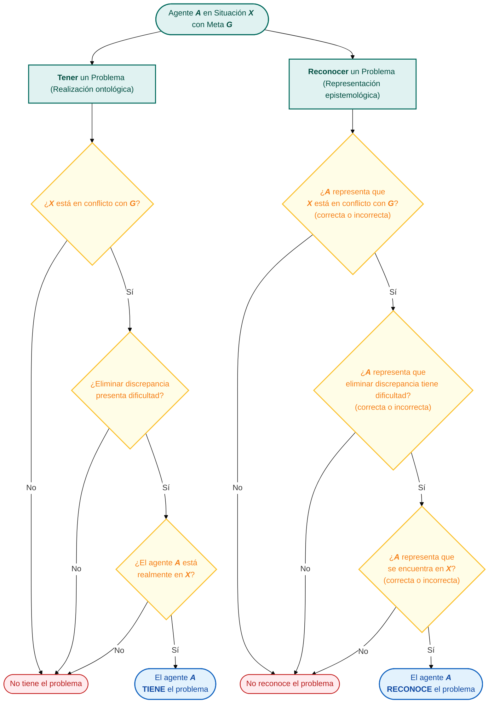

Del latín *problēma,* y este del griero πρόβλημα *próblēma,* es una **brecha o diferencia entre cómo es la situación ahora y cómo te gustaría que fuera.** [^1]. Esto significa que los problemas pueden ser:

[^1]: Brooks J. (2022). The art of problem solving and its translation into practice. Bdj in Practice, 35 (9), 21–23. https://doi.org/10.1038/s41404-022-1714-y

- **Universales**: la misma situación representaría un problema para todo el mundo.
- **Específicos**: la situación es un problema para nosotros o para un grupo de personas determinado.

De manera más precisa, una **situación** $X$ es un **problema** para el **agente** $A$, si, y solo si, (SSI o IFF) la situación $X$ está en **conflicto** con la **meta** $G$ del agente y eliminar la **discrepancia** entre $X$ y $G$ presenta alguna **dificultad** para el agente $A$ [^2]. Además, para que el agente $A$ tenga realmente un problema, también debe estar en dicha situación $X$. En contraste, el agente $A$ reconoce que la situación $X$ es un problema para él SSI:

1. El agente $A$ representa, correcta o incorrectamente, que la situación $X$ está en conflicto con su meta $G$.
2. El agente $A$ representa, correcta o incorrectamente, que eliminar la discrepancia entre $X$ y $G$ presenta alguna dificultad.
3. El agente $A$ representa, correcta o incorrectamente, que se encuentra en la situación $X$.

[^2]: Barseghyan, H., Patton, P., Dechauffour, G., & Henikoff, C. (2024). What are problems? Philosophical Studies, 181(10), 2755–2777. https://doi.org/10.1007/s11098-024-02201-y

Como se ilustra en la **Figura 1**, los criterios necesarios y suficientes del problema operan en dos dominios interrelacionados que describen a un agente $A$ en situación $X$ con meta $G$ (otra situación). Entendiendo que toda situación es un sistema, los dominios son: 

- **Ontológico:** que define la realización material del sistema.
- **Epistemológico:** que define la representación abstracta del sistema.

**Figura 1. Dominios ontológico y epistemológico del problema.** Desglose de los criterios necesarios, suficientes e interrelacionados para determinar un problema desde la perspectiva del agente, la situación actual y la meta (otra situación), en la realización material y representación abstracta del sistema.

> [!important] Varias conclusiones se derivan de estas definiciones:
> 1. **No todos los problemas incluyen preguntas**
> 2. **No todos los problemas incluyen estados indeseables**
> 3. Para que un agente considere una situación como problemática, debe ser **consciente** de la situación; sin embargo, la consciencia de la situación no es necesaria para que un agente **tenga** un problema o para que una situación **sea** un problema para un agente.
> 4. Los **contextos** no tienen por qué ser parte del problema: el contexto de un problema específico no tiene por qué ser también parte de un problema más general.
> 5. La **eliminación completa de la discrepancia** entre una situación y una meta **elimina el problema**, mientras que el **problema continúa existiendo** cuando recibe una **solución parcial**.
> 6. Para que algo sea **un problema, no tiene por qué ser solucionable,** y el agente no tiene que aceptar que se deba hacer algo al respecto, ni debe utilizar el lenguaje de lo mejorable/solucionable.