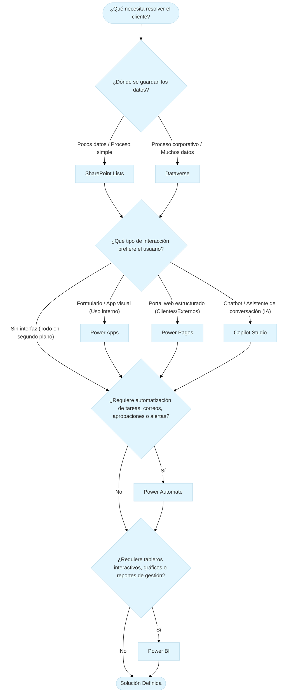

# Define: Power Platform

> Ecosistema de bajo código (*low-code*) de Microsoft diseñado para construir soluciones de negocio integradas de extremo a extremo. Permite digitalizar procesos, automatizar flujos, analizar datos y desplegar portales o agentes de IA, conectados de forma nativa sobre **Microsoft Dataverse**. [Fuente](https://learn.microsoft.com/en-us/power-platform/developer/get-started).

**Componentes clave del ecosistema**

- **Copilot Studio:** Desarrollo y personalización de agentes virtuales y chatbots conversacionales con IA. **Interacción Conversacional**.
- **Power Apps:** Creación de aplicaciones empresariales personalizadas (web y móvil) para interacción y toma de datos. **Lectura y Escritura (CRUD)**.
- **Power Automate:** Automatización de flujos de trabajo y tareas repetitivas entre aplicaciones de nube y escritorio. **Lógica y Procesamiento**.
- **Power BI:** Inteligencia de negocios y visualización de datos mediante paneles e informes interactivos. **Lectura y Análisis (*Read-Only*)**.
- **Power Pages:** Sitios web empresariales seguros y estructurados, diseñados para interacción con usuarios externos. **Lectura y Escritura (CRUD para externos)**.

**Capa de almacenamiento e integración:** Es la base de datos relacional y segura (**Microsoft Dataverse**) que actúa como motor central nativo. Permite que los cinco componentes compartan la misma información sin necesidad de integraciones complejas ni código adicional. En escenarios sencillos o de bajo presupuesto, esta capa también puede ser suplida por fuentes ligeras como **SharePoint Lists**. **Almacenamiento y Conectividad**.

## Árbol de decisión Power Platform

A continuación se describe un diagrama conceptual simplificado sobre 4 preguntas de negocio y que componente sugerir de Power Platform.

### Preguntas de negocio

1. **¿Dónde se guardan los datos?**
2. **¿Qué tipo de interacción prefiere el usuario?**
3. **¿Requiere automatización de tareas, correos, aprobaciones o alertas?**
4. **¿Requiere tableros interactivos, gráficos o reportes de gestión?**

### Árbol de decisión

# Casos prácticos de arquitectura funcional

Esta sección reúne una serie de simulaciones operativas basadas en problemáticas reales de negocio. Cada caso de estudio aplica el árbol de decisión funcional (Almacenamiento, Interfaz, Lógica y Analítica) para traducir necesidades operativas en arquitecturas técnicas dentro del ecosistema de Microsoft Power Platform, sirviendo de fundamento directo para la formulación de las directrices de implementación.

## Caso 1: Solicitudes de mantenimiento interno (Oficina)

- **Problema:**
    *Mira Fer, tenemos un problema con las solicitudes de mantenimiento de equipos de oficina. Hoy en día, los 60 empleados de la empresa me envían un correo o un mensaje por Teams cada vez que se daña una silla, una pantalla o la impresora. Mi equipo anota todo a mano en un Excel local. Después le mandamos un correo al técnico externo para que venga a revisar, y cuando termina, el jefe de área tiene que autorizar el pago por correo. Es un caos: se nos traspapelan las fotos de los fallos, no sabemos en qué estado está cada arreglo y, para colmo, la gerencia general me pide todos los meses saber en qué departamentos estamos gastando más dinero en reparaciones y nunca tengo los datos a tiempo.*
- **Arquitectura clave:** Power Apps (Lienzo) + SharePoint Lists + Power Automate + Power BI.
- **Directrices derivadas:** Puntos 1 al 6.

## Caso 2: Portal de postulación y registro (Usuarios externos)

- **Problema:**
    *Hola Fer. Ofrecemos cursos y certificaciones a profesionales de distintas empresas. Hoy el proceso de postulación es un dolor de cabeza: los postulantes nos envían sus datos y certificados por correo electrónico, pero no tienen cómo saber si su postulación fue recibida o aprobada, así que colapsan la mesa de ayuda con llamadas. Queremos un sitio web corporativo seguro donde los postulantes externos puedan registrarse, subir sus documentos de respaldo (título, CV) y consultar en qué estado va su trámite sin necesidad de llamar a nadie. Además, cuando el equipo interno revise y apruebe la postulación, el sistema debe enviarle automáticamente al alumno su carta de bienvenida con la contraseña temporal de acceso. Por último, la dirección necesita un tablero para ver en tiempo real el número de postulantes por curso, el porcentaje de aprobados y las regiones del país con mayor demanda.*
- **Arquitectura clave:** Power Apps (Lienzo) + Dataverse + Power Automate + Power BI.
- **Directrices derivadas:** Puntos 7 al 10.

## Caso 3: Control de mantenimiento e incidencias en pontones (Acuícola)

- **Problema:**
    *Hola Fer. En nuestros centros de cultivo en el mar (pontones), los operarios de turno realizan inspecciones diarias del estado de las redes loberas, los sistemas de aireación y las bombas de oxígeno. Hoy día los muchachos completan esas pautas de inspección en planillas de papel o archivos de Excel locales en el pontón. Cuando ocurre una incidencia grave —por ejemplo, el desgaste crítico de una red o una falla en un generador—, el reporte se envía por correo cuando hay enlace satelital o cuando la embarcación llega a puerto. A veces nos enteramos 24 o 48 horas después. Necesitamos una herramienta para que el técnico en el pontón pueda registrar la inspección o la alerta en terreno (incluso desde una tablet), adjuntando la foto de la red o del equipo dañado. Si la incidencia es clasificada como 'Crítica', el Jefe de Operaciones en la oficina central debe recibir una alerta inmediata para aprobar el despacho de una cuadrilla de buzos o técnicos de reparación. Por último, la Gerencia de Operaciones necesita un panel central para monitorear el estado de mantenimiento de todos los centros de cultivo de la agrupación (barrios), ver cuántas incidencias críticas hay abiertas y evaluar los tiempos de respuesta de las cuadrillas.*
- **Arquitectura clave:** Canvas App (Offline) + Model-Driven App + Dataverse + Power Automate Condicional + Power BI.
- **Directrices derivadas:** Puntos 11 al 14.

## Caso 4: Ingesta y tabulación automatizada de correos heterogéneos

- **Problema:**
    *Hola Fer. En la empresa recibimos diariamente un volumen importante de correos electrónicos con solicitudes e información clave que necesitamos tabular sí o sí en una base de datos centralizada. El gran dolor de cabeza es que estos correos no vienen siempre con la misma forma: algunos traen datos estructurados con etiquetas claras, pero otros vienen redactados en lenguaje libre o con campos faltantes. Hoy perdemos horas copiando y pegando datos a mano en planillas, y cuando un correo viene incompleto no nos damos cuenta a tiempo para pedir la información faltante. Necesitamos una solución lo más liviana y económica posible: que el sistema procese automáticamente la bandeja de entrada, registre los datos tabulados en un repositorio central y, si detecta un correo con atributos faltantes, nos alerte o lo mueva a una carpeta de revisión sin contaminar la base de datos.*
- **Arquitectura clave:** Power Automate (Orquestación e Ingesta desatendida) + SharePoint Lists (Backend de almacenamiento liviano) + Reglas de Validación / Human-in-the-Loop.
- **Directrices derivadas:** Puntos 15 al 18.

# Directrices para Power Platform

A continuación se presenta una lista ordenada de consejos o datos prácticos para trabajar con Power Platform. Cada directriz tiene la estructura `Acción + Efecto + Sustento`:

> 1. [Nombre de la directriz con verbo en infinitivo y plataforma]
>    - **Acción:** [Qué se hace concretamente en la plataforma]
>    - **Efecto:** [Qué resultado inmediato produce en la solución]
>    - **Sustento:** [Razón técnica o de negocio que justifica la decisión]

---

1. **Incrustar aplicaciones de Power Apps como pestañas nativas en Microsoft Teams**
   
   - **Acción:** Desplegar la interfaz de la aplicación empresarial como una pestaña fija dentro de un equipo o canal de Microsoft Teams.
   - **Efecto:** Otorga un acceso directo a la solución dentro del entorno colaborativo diario de las personas usuarias sin requerir navegadores ni URLs externas.
   - **Sustento:** Disminuye la fricción de uso, evita la pérdida de enlaces corporativos y maximiza la tasa de adopción del sistema en la organización.

2. **Implementar tarjetas adaptativas de aprobación en Power Automate**
   
   - **Acción:** Utilizar el conector nativo "Crear y esperar una aprobación" para enviar tarjetas interactivas directamente al chat de Microsoft Teams o correo electrónico.
   - **Efecto:** Permite a las jefaturas autorizar o rechazar solicitudes mediante botones interactivos en tiempo real, sin ingresar manualmente a la base de datos o aplicación.
   - **Sustento:** Agiliza los tiempos de respuesta de los procesos de decisión, reduce errores por manipulación directa de registros y centraliza las auditorías de estado.

3. **Almacenar evidencia multimedia mediante columnas tipo Imagen o Adjuntos nativos**
   
   - **Acción:** Configurar campos nativos de tipo "Imagen" o "Adjunto" en listas de SharePoint o tablas de Dataverse para la carga directa de fotografías desde Power Apps.
   - **Efecto:** Asocia automáticamente los archivos multimedia al registro correspondiente de la base de datos sin gestionar rutas de servidor ni carpetas manuales.
   - **Sustento:** Simplifica la arquitectura de archivos, garantiza la integridad referencial entre el dato y su evidencia visual, y agiliza la toma de datos en terreno.

4. **Empaquetar componentes de proyecto dentro de una Solución en Power Platform**
   
   - **Acción:** Agrupar tablas, aplicaciones, flujos de trabajo y tableros bajo el contenedor unificado llamado "Solución" (*Solution*).
   - **Efecto:** Mantiene todos los artefactos de un proyecto interconectados y estructurados bajo el mismo ciclo de vida de desarrollo.
   - **Sustento:** Facilita la migración entre ambientes (Desarrollo, UAT y Producción), evita elementos desvinculados y simplifica el mantenimiento del sistema a largo plazo.

5. **Acelerar el ensamble técnico mediante solicitudes en lenguaje natural con Copilot**
   
   - **Acción:** Describir la lógica de negocio o la estructura del flujo de trabajo en español dentro de la interfaz asistida por IA de Power Automate y Power Apps.
   - **Efecto:** Genera automáticamente el esqueleto funcional de bloques, desencadenadores y condiciones de la solución sin requerir construcción manual desde cero.
   - **Sustento:** Optimiza los tiempos de desarrollo técnico, reduce errores de sintaxis y permite enfocar la tarea intelectual en el diseño arquitectónico y el levantamiento de requisitos.

6. **Desacoplar la interacción con terceros mediante notificaciones automáticas en correo**
   
   - **Acción:** Configurar envíos automáticos de correos con datos específicos a usuarios externos desde Power Automate al cambiar el estado de un registro.
   - **Efecto:** Mantiene informados a los proveedores o clientes externos sobre las acciones aprobadas sin darles acceso a la infraestructura interna.
   - **Sustento:** Mantiene un estándar estricto de seguridad e identidad, evita el consumo innecesario de licencias externas y simplifica la comunicación operativa.

7. **Separar las interfaces de usuarios externos e internos combinando Power Pages y Power Apps**
   
   - **Acción:** Implementar Power Pages para la captura y consulta de información de actores externos, y Power Apps para la gestión, revisión y aprobación por parte del personal interno.
   - **Efecto:** Delimita los entornos de interacción según el perfil de la persona usuaria sin duplicar estructuras de información.
   - **Sustento:** Optimiza el modelo de licenciamiento, refuerza la seguridad informática y evita exponer paneles de administración interna a usuarios fuera de la organización.

8. **Adoptar Microsoft Dataverse como repositorio central en soluciones con portales web externos**
   
   - **Acción:** Configurar Dataverse como el motor de almacenamiento relacional subyacente para cualquier arquitectura que integre portales de Power Pages.
   - **Efecto:** Habilita la gestión nativa de permisos por roles web (*Web Roles*), la autenticación segura de contactos y el almacenamiento de documentos adjuntos.
   - **Sustento:** Cumple con las normativas corporativas de protección de datos externos y elimina las restricciones de rendimiento o seguridad de orígenes de datos livianos.

9. **Incrustar tableros analíticos de Power BI en entornos de trabajo internos**
   
   - **Acción:** Integrar reportes e informes interactivos de Power BI directamente en las vistas de Power Apps o en las pestañas de Microsoft Teams del equipo directivo.
   - **Efecto:** Permite consultar métricas e indicadores de gestión en tiempo real dentro del contexto operativo habitual del personal interno.
   - **Sustento:** Facilita la toma de decisiones basada en datos, reduce la dispersión de herramientas y restringe el acceso a la inteligencia de negocios solo a roles autorizados.

10. **Estructurar notificaciones automáticas multinivel en Power Automate para el seguimiento de trámites**
    
    - **Acción:** Configurar flujos en Power Automate que envíen notificaciones por correo electrónico tanto al recibir un registro como al actualizar su estado de validación.
    - **Efecto:** Informa proactivamente a las personas usuarias externas sobre la trazabilidad y avance de sus solicitudes en cada etapa del proceso.
    - **Sustento:** Reduce drásticamente la carga operativa y el volumen de llamadas hacia las mesas de ayuda, mejorando la transparencia del servicio.

11. **Diferenciar entre Canvas Apps y Model-Driven Apps según el perfil de uso operativo**
    
    - **Acción:** Diseñar aplicaciones de lienzo (Canvas Apps) para toma de datos ágil en terreno mediante dispositivos móviles, y aplicaciones basadas en modelos (Model-Driven Apps) para la gestión back-office de administración.
    - **Efecto:** Ofrece una experiencia visual optimizada para inspecciones operativas y una interfaz orientada a tablas e indicadores para la toma de decisiones.
    - **Sustento:** Reduce la carga cognitiva en operarios de terreno, acelera el registro de inspecciones y entrega herramientas avanzadas de filtrado a las jefaturas.

12. **Implementar flujos condicionales en Power Automate para la atención de contingencias**
    
    - **Acción:** Configurar reglas de evaluación en Power Automate que activen aprobaciones o alertas urgentes solo cuando el registro cumpla un criterio crítico predefinido.
    - **Efecto:** Filtra las notificaciones rutinarias y escala de forma inmediata los eventos de alto impacto operativo a las jefaturas responsables.
    - **Sustento:** Evita la saturación por sobreinformación en las bandejas de entrada de las jefaturas y garantiza tiempos de respuesta mínimos ante emergencias.

13. **Centralizar la trazabilidad operativa en Dataverse para industrias de alta exigencia**
    
    - **Acción:** Modelar la estructura de activos, centros operativos e incidencias dentro del modelo relacional de Microsoft Dataverse.
    - **Efecto:** Mantiene la integridad referencial entre los datos de terreno, las aprobaciones gerenciales y los históricos de mantenimiento.
    - **Sustento:** Asegura el cumplimiento de auditorías normativas, garantiza alta disponibilidad de datos y sostiene arquitecturas escalables sin riesgo de pérdida de información.

14. **Habilitar capacidades de trabajo sin conexión (modo offline) en aplicaciones de lienzo (Canvas Apps)**
    
    - **Acción:** Configurar la persistencia de datos local y la sincronización diferida en Canvas Apps para la captura de información en zonas con conectividad inestable o nula.
    - **Efecto:** Permite a la persona usuaria completar formularios y adjuntar evidencia fotográfica en el dispositivo móvil sin depender de señal activa, transmitiendo los datos automáticamente al restablecerse la conexión.
    - **Sustento:** Garantiza la continuidad operativa en faenas remotas o aisladas, elimina la pérdida de registros críticos en terreno y evita la duplicación de tareas por reingreso manual de datos.
    
15. **Diseñar arquitecturas desatendidas basadas en eventos para la ingesta de correos electrónicos**
    
    - **Acción:** Configurar desencadenadores automáticos en Power Automate al recibir correos en Outlook para extraer y registrar datos directamente en SharePoint Lists sin interponer aplicaciones de usuario.
    - **Efecto:** Elimina la necesidad de desarrollo de interfaces visuales adicionales (Power Apps) o licenciamiento avanzado, manteniendo la solución liviana, automatizada en segundo plano y costo-eficiente.
    - **Sustento:** Resuelve requerimientos de tabulación operativa utilizando licencias estándar de la suite económica de Microsoft 365 sin incurrir en sobreingeniería.

16. **Implementar patrones de validación condicional y carpetas de revisión (Human-in-the-Loop)**
    
    - **Acción:** Insertar bloques condicionales en Power Automate que evalúen la presencia de atributos obligatorios antes de escribir en la base de datos, enrutando los correos incompletos a una carpeta dedicada de Outlook o asignando un estado de alerta (tabla).
    - **Efecto:** Evita la contaminación del repositorio con datos nulos o incompletos y notifica de inmediato al operador humano para gestionar la corrección con el remitente.
    - **Sustento:** Resguarda la integridad de la base de datos procesada automáticamente y habilita una intervención humana ordenada frente a excepciones en flujos no estructurados.

17. **Empaquetar flujos en Soluciones para la migración e independización de inquilinos (Tenants)**
    
    - **Acción:** Agrupar los flujos de trabajo e infraestructuras de soporte dentro de un paquete de Solución (*Solution*) para su exportación e importación en el entorno de Microsoft 365 del cliente final.
    - **Efecto:** Permite desarrollar y probar la lógica en ambientes de prueba (*sandbox*) y transferirla limpiamente reconfigurando únicamente las conexiones de autenticación local al importar.
    - **Sustento:** Asegura la reutilización de código, simplifica la entrega de proyectos a terceros y garantiza que el procesamiento se ejecute bajo las credenciales y políticas de seguridad del cliente.

18. **Aprovechar funciones de texto nativas antes de implementar servicios cognitivos de IA**
    
    - **Acción:** Extraer variables mediante expresiones nativas de cadena (búsqueda de patrones, delimitadores y condicionales) en Power Automate cuando la información del correo mantenga estructuras o etiquetas mínimas.
    - **Efecto:** Reduce la complejidad técnica y elimina costos recurrentes por consumo de tokens o modelos de IA Builder.
    - **Sustento:** Mantiene la máxima eficiencia presupuestaria en proyectos livianos, reservando el procesamiento mediante inteligencia artificial exclusivamente para textos completamente libres y sin formato.

# Navegación de interfaces en Power Platform

Esta sección documenta el reconocimiento visual y la geografía práctica de los portales de creación (*Maker Portals*), estableciendo el vínculo directo entre los componentes teóricos de la arquitectura y la ubicación de las herramientas de diseño, configuración y navegación dentro del ecosistema de Microsoft Power Platform.

## Power Apps

> https://make.powerapps.com

---
