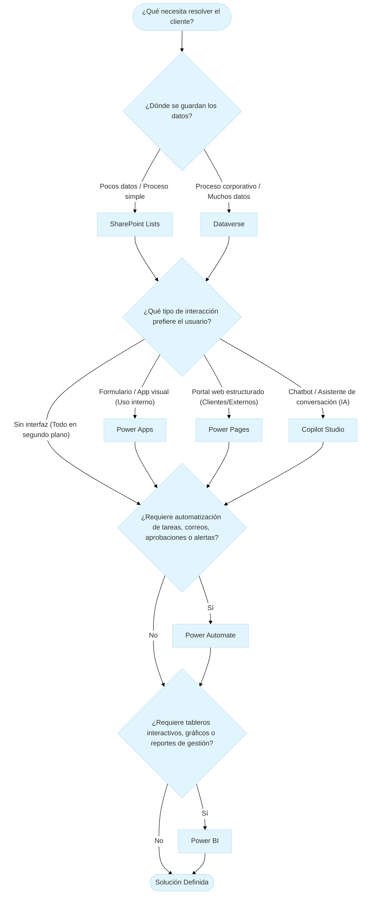

# Define: Power Platform

> Ecosistema de bajo código (*low-code*) de Microsoft diseñado para construir soluciones de negocio integradas de extremo a extremo. Permite digitalizar procesos, automatizar flujos, analizar datos y desplegar portales o agentes de IA, conectados de forma nativa sobre **Microsoft Dataverse**. [Fuente](https://learn.microsoft.com/en-us/power-platform/developer/get-started).

**Componentes clave del ecosistema**

- **Copilot Studio:** Desarrollo y personalización de agentes virtuales y chatbots conversacionales con IA. **Interacción Conversacional**.
- **Power Apps:** Creación de aplicaciones empresariales personalizadas (web y móvil) para interacción y toma de datos. **Lectura y Escritura (CRUD)**.
- **Power Automate:** Automatización de flujos de trabajo y tareas repetitivas entre aplicaciones de nube y escritorio. **Lógica y Procesamiento**.
- **Power BI:** Inteligencia de negocios y visualización de datos mediante paneles e informes interactivos. **Lectura y Análisis (*Read-Only*)**.
- **Power Pages:** Sitios web empresariales seguros y estructurados, diseñados para interacción con usuarios externos. **Lectura y Escritura (CRUD para externos)**.

**Capa de almacenamiento e integración:** Es la base de datos relacional y segura (**Microsoft Dataverse**) que actúa como motor central nativo. Permite que los cinco componentes compartan la misma información sin necesidad de integraciones complejas ni código adicional. En escenarios sencillos o de bajo presupuesto, esta capa también puede ser suplida por fuentes ligeras como **SharePoint Lists**. **Almacenamiento y Conectividad**.

## Árbol de decisión Power Platform

A continuación se describe un diagrama conceptual simplificado sobre 4 preguntas de negocio y que componente sugerir de Power Platform.

### Preguntas de negocio

1. **¿Dónde se guardan los datos?**
2. **¿Qué tipo de interacción prefiere el usuario?**
3. **¿Requiere automatización de tareas, correos, aprobaciones o alertas?**
4. **¿Requiere tableros interactivos, gráficos o reportes de gestión?**

### Árbol de decisión

# Casos prácticos de arquitectura funcional

Esta sección reúne una serie de simulaciones operativas basadas en problemáticas reales de negocio. Cada caso de estudio aplica el árbol de decisión funcional (Almacenamiento, Interfaz, Lógica y Analítica) para traducir necesidades operativas en arquitecturas técnicas dentro del ecosistema de Microsoft Power Platform, sirviendo de fundamento directo para la formulación de las directrices de implementación.

## Caso 1: Solicitudes de mantenimiento interno (Oficina)

- **Problema:**
    *Mira Fer, tenemos un problema con las solicitudes de mantenimiento de equipos de oficina. Hoy en día, los 60 empleados de la empresa me envían un correo o un mensaje por Teams cada vez que se daña una silla, una pantalla o la impresora. Mi equipo anota todo a mano en un Excel local. Después le mandamos un correo al técnico externo para que venga a revisar, y cuando termina, el jefe de área tiene que autorizar el pago por correo. Es un caos: se nos traspapelan las fotos de los fallos, no sabemos en qué estado está cada arreglo y, para colmo, la gerencia general me pide todos los meses saber en qué departamentos estamos gastando más dinero en reparaciones y nunca tengo los datos a tiempo.*
- **Arquitectura clave:** Power Apps (Lienzo) + SharePoint Lists + Power Automate + Power BI.
- **Directrices derivadas:** Puntos 1 al 6.

## Caso 2: Portal de postulación y registro (Usuarios externos)

- **Problema:**
    *Hola Fer. Ofrecemos cursos y certificaciones a profesionales de distintas empresas. Hoy el proceso de postulación es un dolor de cabeza: los postulantes nos envían sus datos y certificados por correo electrónico, pero no tienen cómo saber si su postulación fue recibida o aprobada, así que colapsan la mesa de ayuda con llamadas. Queremos un sitio web corporativo seguro donde los postulantes externos puedan registrarse, subir sus documentos de respaldo (título, CV) y consultar en qué estado va su trámite sin necesidad de llamar a nadie. Además, cuando el equipo interno revise y apruebe la postulación, el sistema debe enviarle automáticamente al alumno su carta de bienvenida con la contraseña temporal de acceso. Por último, la dirección necesita un tablero para ver en tiempo real el número de postulantes por curso, el porcentaje de aprobados y las regiones del país con mayor demanda.*
- **Arquitectura clave:** Power Apps (Lienzo) + Dataverse + Power Automate + Power BI.
- **Directrices derivadas:** Puntos 7 al 10.

## Caso 3: Control de mantenimiento e incidencias en pontones (Acuícola)

- **Problema:**
    *Hola Fer. En nuestros centros de cultivo en el mar (pontones), los operarios de turno realizan inspecciones diarias del estado de las redes loberas, los sistemas de aireación y las bombas de oxígeno. Hoy día los muchachos completan esas pautas de inspección en planillas de papel o archivos de Excel locales en el pontón. Cuando ocurre una incidencia grave —por ejemplo, el desgaste crítico de una red o una falla en un generador—, el reporte se envía por correo cuando hay enlace satelital o cuando la embarcación llega a puerto. A veces nos enteramos 24 o 48 horas después. Necesitamos una herramienta para que el técnico en el pontón pueda registrar la inspección o la alerta en terreno (incluso desde una tablet), adjuntando la foto de la red o del equipo dañado. Si la incidencia es clasificada como 'Crítica', el Jefe de Operaciones en la oficina central debe recibir una alerta inmediata para aprobar el despacho de una cuadrilla de buzos o técnicos de reparación. Por último, la Gerencia de Operaciones necesita un panel central para monitorear el estado de mantenimiento de todos los centros de cultivo de la agrupación (barrios), ver cuántas incidencias críticas hay abiertas y evaluar los tiempos de respuesta de las cuadrillas.*
- **Arquitectura clave:** Canvas App (Offline) + Model-Driven App + Dataverse + Power Automate Condicional + Power BI.
- **Directrices derivadas:** Puntos 11 al 14.

## Caso 4: Ingesta y tabulación automatizada de correos heterogéneos

- **Problema:**
    *Hola Fer. En la empresa recibimos diariamente un volumen importante de correos electrónicos con solicitudes e información clave que necesitamos tabular sí o sí en una base de datos centralizada. El gran dolor de cabeza es que estos correos no vienen siempre con la misma forma: algunos traen datos estructurados con etiquetas claras, pero otros vienen redactados en lenguaje libre o con campos faltantes. Hoy perdemos horas copiando y pegando datos a mano en planillas, y cuando un correo viene incompleto no nos damos cuenta a tiempo para pedir la información faltante. Necesitamos una solución lo más liviana y económica posible: que el sistema procese automáticamente la bandeja de entrada, registre los datos tabulados en un repositorio central y, si detecta un correo con atributos faltantes, nos alerte o lo mueva a una carpeta de revisión sin contaminar la base de datos.*
- **Arquitectura clave:** Power Automate (Orquestación e Ingesta desatendida) + SharePoint Lists (Backend de almacenamiento liviano) + Reglas de Validación / Human-in-the-Loop.
- **Directrices derivadas:** Puntos 15 al 18.

# Directrices para Power Platform

A continuación se presenta una lista ordenada de consejos o datos prácticos para trabajar con Power Platform. Cada directriz tiene la estructura `Acción + Efecto + Sustento`:

> 1. [Nombre de la directriz con verbo en infinitivo y plataforma]
>    - **Acción:** [Qué se hace concretamente en la plataforma]
>    - **Efecto:** [Qué resultado inmediato produce en la solución]
>    - **Sustento:** [Razón técnica o de negocio que justifica la decisión]

---

1. **Incrustar aplicaciones de Power Apps como pestañas nativas en Microsoft Teams**
   
   - **Acción:** Desplegar la interfaz de la aplicación empresarial como una pestaña fija dentro de un equipo o canal de Microsoft Teams.
   - **Efecto:** Otorga un acceso directo a la solución dentro del entorno colaborativo diario de las personas usuarias sin requerir navegadores ni URLs externas.
   - **Sustento:** Disminuye la fricción de uso, evita la pérdida de enlaces corporativos y maximiza la tasa de adopción del sistema en la organización.

2. **Implementar tarjetas adaptativas de aprobación en Power Automate**
   
   - **Acción:** Utilizar el conector nativo "Crear y esperar una aprobación" para enviar tarjetas interactivas directamente al chat de Microsoft Teams o correo electrónico.
   - **Efecto:** Permite a las jefaturas autorizar o rechazar solicitudes mediante botones interactivos en tiempo real, sin ingresar manualmente a la base de datos o aplicación.
   - **Sustento:** Agiliza los tiempos de respuesta de los procesos de decisión, reduce errores por manipulación directa de registros y centraliza las auditorías de estado.

3. **Almacenar evidencia multimedia mediante columnas tipo Imagen o Adjuntos nativos**
   
   - **Acción:** Configurar campos nativos de tipo "Imagen" o "Adjunto" en listas de SharePoint o tablas de Dataverse para la carga directa de fotografías desde Power Apps.
   - **Efecto:** Asocia automáticamente los archivos multimedia al registro correspondiente de la base de datos sin gestionar rutas de servidor ni carpetas manuales.
   - **Sustento:** Simplifica la arquitectura de archivos, garantiza la integridad referencial entre el dato y su evidencia visual, y agiliza la toma de datos en terreno.

4. **Empaquetar componentes de proyecto dentro de una Solución en Power Platform**
   
   - **Acción:** Agrupar tablas, aplicaciones, flujos de trabajo y tableros bajo el contenedor unificado llamado "Solución" (*Solution*).
   - **Efecto:** Mantiene todos los artefactos de un proyecto interconectados y estructurados bajo el mismo ciclo de vida de desarrollo.
   - **Sustento:** Facilita la migración entre ambientes (Desarrollo, UAT y Producción), evita elementos desvinculados y simplifica el mantenimiento del sistema a largo plazo.

5. **Acelerar el ensamble técnico mediante solicitudes en lenguaje natural con Copilot**
   
   - **Acción:** Describir la lógica de negocio o la estructura del flujo de trabajo en español dentro de la interfaz asistida por IA de Power Automate y Power Apps.
   - **Efecto:** Genera automáticamente el esqueleto funcional de bloques, desencadenadores y condiciones de la solución sin requerir construcción manual desde cero.
   - **Sustento:** Optimiza los tiempos de desarrollo técnico, reduce errores de sintaxis y permite enfocar la tarea intelectual en el diseño arquitectónico y el levantamiento de requisitos.

6. **Desacoplar la interacción con terceros mediante notificaciones automáticas en correo**
   
   - **Acción:** Configurar envíos automáticos de correos con datos específicos a usuarios externos desde Power Automate al cambiar el estado de un registro.
   - **Efecto:** Mantiene informados a los proveedores o clientes externos sobre las acciones aprobadas sin darles acceso a la infraestructura interna.
   - **Sustento:** Mantiene un estándar estricto de seguridad e identidad, evita el consumo innecesario de licencias externas y simplifica la comunicación operativa.

7. **Separar las interfaces de usuarios externos e internos combinando Power Pages y Power Apps**
   
   - **Acción:** Implementar Power Pages para la captura y consulta de información de actores externos, y Power Apps para la gestión, revisión y aprobación por parte del personal interno.
   - **Efecto:** Delimita los entornos de interacción según el perfil de la persona usuaria sin duplicar estructuras de información.
   - **Sustento:** Optimiza el modelo de licenciamiento, refuerza la seguridad informática y evita exponer paneles de administración interna a usuarios fuera de la organización.

8. **Adoptar Microsoft Dataverse como repositorio central en soluciones con portales web externos**
   
   - **Acción:** Configurar Dataverse como el motor de almacenamiento relacional subyacente para cualquier arquitectura que integre portales de Power Pages.
   - **Efecto:** Habilita la gestión nativa de permisos por roles web (*Web Roles*), la autenticación segura de contactos y el almacenamiento de documentos adjuntos.
   - **Sustento:** Cumple con las normativas corporativas de protección de datos externos y elimina las restricciones de rendimiento o seguridad de orígenes de datos livianos.

9. **Incrustar tableros analíticos de Power BI en entornos de trabajo internos**
   
   - **Acción:** Integrar reportes e informes interactivos de Power BI directamente en las vistas de Power Apps o en las pestañas de Microsoft Teams del equipo directivo.
   - **Efecto:** Permite consultar métricas e indicadores de gestión en tiempo real dentro del contexto operativo habitual del personal interno.
   - **Sustento:** Facilita la toma de decisiones basada en datos, reduce la dispersión de herramientas y restringe el acceso a la inteligencia de negocios solo a roles autorizados.

10. **Estructurar notificaciones automáticas multinivel en Power Automate para el seguimiento de trámites**
    
    - **Acción:** Configurar flujos en Power Automate que envíen notificaciones por correo electrónico tanto al recibir un registro como al actualizar su estado de validación.
    - **Efecto:** Informa proactivamente a las personas usuarias externas sobre la trazabilidad y avance de sus solicitudes en cada etapa del proceso.
    - **Sustento:** Reduce drásticamente la carga operativa y el volumen de llamadas hacia las mesas de ayuda, mejorando la transparencia del servicio.

11. **Diferenciar entre Canvas Apps y Model-Driven Apps según el perfil de uso operativo**
    
    - **Acción:** Diseñar aplicaciones de lienzo (Canvas Apps) para toma de datos ágil en terreno mediante dispositivos móviles, y aplicaciones basadas en modelos (Model-Driven Apps) para la gestión back-office de administración.
    - **Efecto:** Ofrece una experiencia visual optimizada para inspecciones operativas y una interfaz orientada a tablas e indicadores para la toma de decisiones.
    - **Sustento:** Reduce la carga cognitiva en operarios de terreno, acelera el registro de inspecciones y entrega herramientas avanzadas de filtrado a las jefaturas.

12. **Implementar flujos condicionales en Power Automate para la atención de contingencias**
    
    - **Acción:** Configurar reglas de evaluación en Power Automate que activen aprobaciones o alertas urgentes solo cuando el registro cumpla un criterio crítico predefinido.
    - **Efecto:** Filtra las notificaciones rutinarias y escala de forma inmediata los eventos de alto impacto operativo a las jefaturas responsables.
    - **Sustento:** Evita la saturación por sobreinformación en las bandejas de entrada de las jefaturas y garantiza tiempos de respuesta mínimos ante emergencias.

13. **Centralizar la trazabilidad operativa en Dataverse para industrias de alta exigencia**
    
    - **Acción:** Modelar la estructura de activos, centros operativos e incidencias dentro del modelo relacional de Microsoft Dataverse.
    - **Efecto:** Mantiene la integridad referencial entre los datos de terreno, las aprobaciones gerenciales y los históricos de mantenimiento.
    - **Sustento:** Asegura el cumplimiento de auditorías normativas, garantiza alta disponibilidad de datos y sostiene arquitecturas escalables sin riesgo de pérdida de información.

14. **Habilitar capacidades de trabajo sin conexión (modo offline) en aplicaciones de lienzo (Canvas Apps)**
    
    - **Acción:** Configurar la persistencia de datos local y la sincronización diferida en Canvas Apps para la captura de información en zonas con conectividad inestable o nula.
    - **Efecto:** Permite a la persona usuaria completar formularios y adjuntar evidencia fotográfica en el dispositivo móvil sin depender de señal activa, transmitiendo los datos automáticamente al restablecerse la conexión.
    - **Sustento:** Garantiza la continuidad operativa en faenas remotas o aisladas, elimina la pérdida de registros críticos en terreno y evita la duplicación de tareas por reingreso manual de datos.
    
15. **Diseñar arquitecturas desatendidas basadas en eventos para la ingesta de correos electrónicos**
    
    - **Acción:** Configurar desencadenadores automáticos en Power Automate al recibir correos en Outlook para extraer y registrar datos directamente en SharePoint Lists sin interponer aplicaciones de usuario.
    - **Efecto:** Elimina la necesidad de desarrollo de interfaces visuales adicionales (Power Apps) o licenciamiento avanzado, manteniendo la solución liviana, automatizada en segundo plano y costo-eficiente.
    - **Sustento:** Resuelve requerimientos de tabulación operativa utilizando licencias estándar de la suite económica de Microsoft 365 sin incurrir en sobreingeniería.

16. **Implementar patrones de validación condicional y carpetas de revisión (Human-in-the-Loop)**
    
    - **Acción:** Insertar bloques condicionales en Power Automate que evalúen la presencia de atributos obligatorios antes de escribir en la base de datos, enrutando los correos incompletos a una carpeta dedicada de Outlook o asignando un estado de alerta (tabla).
    - **Efecto:** Evita la contaminación del repositorio con datos nulos o incompletos y notifica de inmediato al operador humano para gestionar la corrección con el remitente.
    - **Sustento:** Resguarda la integridad de la base de datos procesada automáticamente y habilita una intervención humana ordenada frente a excepciones en flujos no estructurados.

17. **Empaquetar flujos en Soluciones para la migración e independización de inquilinos (Tenants)**
    
    - **Acción:** Agrupar los flujos de trabajo e infraestructuras de soporte dentro de un paquete de Solución (*Solution*) para su exportación e importación en el entorno de Microsoft 365 del cliente final.
    - **Efecto:** Permite desarrollar y probar la lógica en ambientes de prueba (*sandbox*) y transferirla limpiamente reconfigurando únicamente las conexiones de autenticación local al importar.
    - **Sustento:** Asegura la reutilización de código, simplifica la entrega de proyectos a terceros y garantiza que el procesamiento se ejecute bajo las credenciales y políticas de seguridad del cliente.

18. **Aprovechar funciones de texto nativas antes de implementar servicios cognitivos de IA**
    
    - **Acción:** Extraer variables mediante expresiones nativas de cadena (búsqueda de patrones, delimitadores y condicionales) en Power Automate cuando la información del correo mantenga estructuras o etiquetas mínimas.
    - **Efecto:** Reduce la complejidad técnica y elimina costos recurrentes por consumo de tokens o modelos de IA Builder.
    - **Sustento:** Mantiene la máxima eficiencia presupuestaria en proyectos livianos, reservando el procesamiento mediante inteligencia artificial exclusivamente para textos completamente libres y sin formato.

# Navegación de interfaces en Power Platform

Esta sección documenta el reconocimiento visual y la geografía práctica de los portales de creación (*Maker Portals*), estableciendo el vínculo directo entre los componentes teóricos de la arquitectura y la ubicación de las herramientas de diseño, configuración y navegación dentro del ecosistema de Microsoft Power Platform.

## Power Apps

> https://make.powerapps.com

---

### 1. El portal de creación y el selector de entorno (`make.powerapps.com`)

Esta es la pantalla principal o centro de comando de Power Apps (`make.powerapps.com`) (**Fig.1**), el punto de partida fundamental para todo creador y consultor funcional. Desde este portal de desarrollo (*Maker Portal*), se gestiona la creación de interfaces de usuario, la conexión con el motor de base de datos relacional y el empaquetamiento de soluciones corporativas.

- **Barra Superior:** Contiene la barra de búsqueda central para localizar componentes, el selector de entorno a la derecha (que indica en qué espacio de trabajo o servidor nos encontramos, como un entorno de desarrollo), notificaciones del sistema, el menú de ayuda y el perfil de usuario activo.
- **Menú Lateral Izquierdo:** El panel de navegación estructurado que organiza las herramientas de trabajo:
  - **Inicio y Crear:** Accesos para iniciar nuevas aplicaciones desde cero, plantillas o diseño asistido.
  - **Learn y Planes:** Guías de aprendizaje y gestión de licencias o capacidades de la plataforma.
  - **Aplicaciones y Centro de IA:** Visualización de las apps creadas y módulos de inteligencia artificial.
  - **Tablas, Flujos y Soluciones:** Los pilares arquitectónicos clave para administrar Dataverse, automatizar procesos (Power Automate) y empaquetar artefactos para migración a otros ambientes.
- **Área Central de Trabajo:** Muestra las opciones rápidas para "Comenzar con el diseño", "Comenzar con datos" o "Comenzar con un plan", además de las pestañas (*Aplicaciones*, *Planes*, *Soluciones*) que enlistan los elementos creados en el ambiente actual.

![[gui_power-platform_fig1_2026-09-30T122121_power-apps.png]]
**Figura 1.** Inicio Power Apps.

### 2. El panel de exploración y el centro de administración de Power Platform

Al hacer clic en el botón inferior izquierdo de **Power Platform** (**Fig.2**), se despliega el menú de navegación general que conecta los distintos portales del ecosistema (*Maker Portals*). Entre ellos destaca un componente crítico para la administración corporativa:

- **Centro de administración de Power Platform (`admin.powerplatform.microsoft.com`):** Es el panel exclusivo para administradores de TI y consultores senior. Desde aquí no se construyen aplicaciones ni flujos, sino que se gestionan los **Entornos** (*Environments*), las directrices de prevención de pérdida de datos (Políticas DLP), las capacidades de Dataverse, la seguridad corporativa, las licencias y la asignación de recursos para toda la organización.

![[gui_power-platform_fig2_2026-09-30T125657_power-apps.png]]
**Figura 2.** Explorar Power Platform.

### 3. El motor de datos: Microsoft Dataverse (`Tablas`)

Al hacer clic en la opción **Tablas** del menú lateral izquierdo dentro de `make.powerapps.com` (**Fig.3**), ingresamos directamente al explorador de **Microsoft Dataverse**. Este es el corazón relacional de la plataforma, donde se estructuran los datos de negocio de forma segura y escalable.

- **Barra de Acciones Superior:** Permite crear nuevas tablas personalizadas (*+ Nueva tabla*), importar o exportar esquemas de datos desde fuentes externas, y analizar la información.
- **Opciones de Creación Rápida:** La sección superior ofrece atajos para generar tablas mediante Inteligencia Artificial con Copilot, partir desde un lienzo en blanco, importar un archivo `.CSV` o Excel, o bien conectar directamente con listas de SharePoint.
- **El Listado de Tablas (*Dataverse*):** Muestra el repositorio central de entidades del sistema. Se divide en:
  - **Tablas Estándar / del Sistema:** Tablas preconstruidas por Microsoft que vienen listas para usar (como *Cuenta*, *Contacto*, *Cita*, *Correo electrónico*, etc.).
  - **Tablas Personalizadas:** Las que tú misma diseñas a la medida para resolver los requerimientos específicos de tus casos de estudio (por ejemplo, la tabla de *Centros*, *Equipos* o *Incidencias* para la salmonera).
- **Columnas de Metadatos:** La tabla indica de forma clara el nombre legible, el nombre lógico interno del sistema (`name`), el tipo de tabla (*Standard*, *Activity*), y si son administradas o personalizables**.

![[gui_power-platform_fig3_2026-09-30T133041_power-apps.png]]
**Figura 3.** Tablas Microsoft Dataverse.

#### Nota arquitectónica: El Common Data Model (CDM)

El conjunto de tablas estándar que observamos en Dataverse (tales como *Cuenta*, *Contacto*, *Cita*, etc.) no es aleatorio; responde a una estructura universal conocida como **Common Data Model (CDM)**.

- **Definición conceptual:** Es un lenguaje de datos compartido, de código abierto y estandarizado, definido por Microsoft en colaboración con la industria. Su propósito es proporcionar una semántica y una estructura unificada para entidades empresariales comunes.
- **Ventaja funcional y de integración:** Al utilizar el CDM, diferentes aplicaciones (tanto de Power Platform como de Dynamics 365 o herramientas externas compatibles) pueden leer, escribir y comprender los datos de manera consistente, evitando la duplicidad de información y facilitando la interoperabilidad entre distintos sistemas corporativos sin necesidad de crear esquemas desde cero.

### 4. Opciones de Creación y Despliegue de Nuevas Tablas en Dataverse (`Tablas`)

Al hacer clic en el botón **+ Nueva tabla** dentro del explorador de Dataverse (**Fig.4**), la plataforma despliega un menú con tres metodologías diferentes para la creación de entidades, adaptándose a distintos requerimientos de proyecto:

- **Crear nuevas tablas:** Es la opción guiada y moderna orientada a la experiencia visual directa en el portal. Permite configurar la tabla definiendo sus propiedades principales de forma interactiva y rápida.
- **Tabla (propiedades avanzadas):** Es la opción de nivel experto y de uso más común para proyectos corporativos complejos. Al seleccionarla, se abre el panel completo de configuración donde el consultor define explícitamente el **Nombre en plural**, el **Nombre singular**, la **Nombre de esquema** (prefijo del editor), y opciones avanzadas como habilitar pistas de auditoría, adjuntar archivos o adjuntar notas, y si la tabla funcionará como una entidad de tipo actividad o estándar.
- **Crear una tabla virtual:** Es una opción de arquitectura avanzada que permite conectar e integrar datos externos alojados en sistemas de terceros (como bases de datos SQL externas, SharePoint, u otros servicios web) **sin necesidad de duplicar ni replicar físicamente los datos** dentro de Dataverse. La tabla virtual actúa como un puente en tiempo real que mapea la información externa para que Power Apps y Model-Driven Apps la consuman como si viviera nativamente en el sistema.

![[gui_power-platform_fig4_2026-09-30T135131_power-apps.png]]
**Figura 4.** Dataverse nueva tabla.

### 5. Mecanismos de importación de datos en Dataverse (`Tablas`)

Al hacer clic en el botón **Importar** en la barra superior del explorador de tablas (**Fig.5**), la plataforma ofrece dos vías principales para incorporar datos masivos hacia Dataverse:

- **Importar datos con flujos de datos (*Dataflows*):** Es la herramienta de nivel empresarial basada en Power Query. Permite conectar con múltiples fuentes de datos externas (bases de datos SQL, archivos en la nube, APIs, etc.), aplicar transformaciones, limpieza y modelado de datos de forma automatizada (*ETL: Extract, Transform, Load*), y programar actualizaciones periódicas hacia las tablas de Dataverse.
- **Importar datos desde Excel:** Es la vía rápida y directa para cargas puntuales o iniciales. Permite mapear hojas de cálculo locales en formato Excel para inyectar registros directamente en las entidades del sistema de manera guiada.

![[gui_power-platform_fig5_2026-09-30T135938_power-apps.png]]
**Figura 5.** Dataverse importar.

### 6. Capa de análisis y conectividad analítica en Dataverse (`Tablas`)

Al hacer clic en el botón **Analizar** de la barra superior (**Fig.6**), la plataforma permite explotar la información almacenada en Dataverse conectándola directamente con herramientas de inteligencia de negocio y análisis a gran escala:

- **Analizar en Power BI:** Genera de manera automática informes rápidos o conecta los conjuntos de datos tabulares directamente con Power BI Desktop y el servicio en la nube, permitiendo construir dashboards interactivos y métricas de rendimiento sobre las entidades del sistema sin requerir configuraciones complejas de conexión.
- **Analizar en Fabric:** Es la opción de integración con **Microsoft Fabric**, la plataforma de datos unificada de nivel empresarial de siguiente generación. Permite enlazar Dataverse con OneLake para realizar análisis de macrodatos (*Big Data*), ciencia de datos e ingeniería de datos con Apache Spark y SQL analítico en tiempo real sobre los mismos datos transaccionales.

![[gui_power-platform_fig6_2026-09-30T140721_power-apps.png]]
**Figura 6.** Dataverse analizar.

### 7. Inventario y gestión de aplicaciones (`Aplicaciones`)

La pestaña **Aplicaciones** en el menú lateral izquierdo funciona como el catálogo central del entorno (**Fig.7**), permitiendo administrar el ciclo de vida, ejecución y permisos de las interfaces desarrolladas.

- **Barra de Acciones Superior:**
  - **+ Nueva aplicación:** Botón principal para iniciar la construcción de una nueva solución. Al hacer clic, despliega cuatro modalidades de desarrollo:
    - *Empezar con Copilot:* Utiliza inteligencia artificial generativa conversacional para estructurar la aplicación y sus tablas de soporte mediante instrucciones en lenguaje natural.
    - *Empezar con datos:* Parte desde un origen de datos existente (como una tabla de Dataverse) para generar de forma automatizada las vistas y formularios principales de una aplicación basada en modelos.
    - *Empezar con un diseño de página:* Enfoque visual orientado a componer la interfaz de usuario píxel a píxel (*Canvas Apps* para tabletas o dispositivos móviles) de manera personalizada.
    - *Empezar desde una plantilla de aplicación:* Utiliza modelos preconstruidos por Microsoft o la comunidad para acelerar el desarrollo sobre una base funcional.
  - **Importar aplicación:** Herramienta para incorporar aplicaciones desarrolladas previamente en otros entornos o guardadas localmente. Despliega dos rutas de importación:
    - *Desde un paquete (.zip):* Importa un paquete exportado completo desde otro entorno de Power Apps, integrando la solución con sus metadatos y configuraciones asociadas.
    - *Desde archivo (.msapp):* Carga directamente el archivo fuente local de una aplicación de lienzo (*Canvas App*) guardado en el equipo para editarlo o desplegarlo en el entorno actual.
  - **Supervisar (*Monitor*):** Consola de diagnóstico y depuración en tiempo real que permite analizar el rendimiento, medir tiempos de respuesta y revisar errores en las llamadas a datos de las aplicaciones.
- **Filtros de inventario y clasificación:**
  - Pestañas de organización (**Mis aplicaciones**, **Compartidos conmigo**, **Todos**) que ayudan a filtrar las soluciones según la propiedad o los permisos delegados en la organización.
  - **Metadatos de seguimiento:** La vista en lista clasifica los elementos por *Nombre*, fecha de *Modificación*, *Propietario* y el **Tipo** de aplicación (donde se distingue visualmente si es de Lienzo o Basada en Modelos).

![[gui_power-platform_fig7_2026-09-30T141534_power-apps.png]]
**Figura 7.** Aplicaciones.

### 8. Gestión del ciclo de vida y soluciones (`Soluciones`)

La pestaña **Soluciones** en el menú lateral izquierdo funciona como el contenedor central para empaquetar, versionar y desplegar componentes personalizados (*ALM: Application Lifecycle Management*) (**Fig.8**).

- **Barra de Acciones Superior:**
  - **+ Nueva solución:** Permite crear un contenedor personalizado definiendo un nombre, un publicador (*Publisher*) y un prefijo de prefijación para las tablas y campos.
  - **Importar solución:** Facilita la carga de paquetes empaquetados (`.zip`) de soluciones completas desarrolladas por terceros o migradas desde otros entornos.
  - **Abrir AppSource:** Conecta con el catálogo de aplicaciones y plantillas oficiales de Microsoft y socios estratégicos.
  - **Publicar todas las personalizaciones:** Aplica de golpe todos los cambios pendientes en el entorno para que se actualicen en las interfaces y metadatos del sistema.
  - **Establecer solución preferida:** Define cuál es la solución activa predeterminada sobre la cual se registrarán por defecto los nuevos componentes que vayas creando.
  - **Ver el historial y Conectarse a Git:** Herramientas de trazabilidad y control de versiones para la integración continua y el seguimiento de implementaciones.
- **Filtros y Vistas del Listado:**
  - Pestañas de clasificación (**No administradas**, **Administradas**, **Todas**). Las soluciones *no administradas* son las que estás editando y modificando activamente, mientras que las *administradas* son paquetes cerrados listos para producción.
  - **Metadatos de Solución:** La tabla detalla el *Nombre para mostrar*, el *Nombre* lógico del sistema, la *Última modificación*, la *Versión* actual (por ejemplo, `1.0.0.0`), el *Publicador*, el estado de comprobación y el estado de control de origen (Git).

![[gui_power-platform_fig8_2026-09-30T151140_power-apps.png]]
**Figura 8.** Soluciones.

### 9. Automatización de procesos y lógica de negocio (`Flujos`)

La pestaña **Flujos** en el menú lateral izquierdo integra las capacidades de **Power Automate** (**Fig.9**), permitiendo diseñar flujos de trabajo automatizados para conectar aplicaciones, sincronizar datos, enviar notificaciones y ejecutar procesos repetitivos sin intervención manual.

- **Barra de acciones superior y pestañas de navegación:**
  - **+ Nuevo flujo:** Botón de inicio rápido para crear automatizaciones directamente.
  - **Clasificación de Automatizaciones:** El panel organiza las vistas según el alcance operativo:
    - *Flujos de nube:* Automatizaciones basadas en eventos desencadenantes en la nube (como la creación de un registro en Dataverse o la llegada de un correo).
    - *Flujos de escritorio (RPA):* Automatizaciones orientadas a la robótica de procesos de interfaz de usuario en aplicaciones locales o web heredadas.
    - *Pruebas de flujo de escritorio y plantillas:* Espacios para validar ejecuciones locales y reutilizar estructuras predefinidas.
    - *Compartido conmigo:* Listado de flujos colaborativos delegados por otros usuarios del entorno.
- **Catálogo de Plantillas (*Templates*):**
  - La sección inferior ofrece recomendaciones y plantillas preconstruidas por Microsoft y la comunidad (como botones de activación rápida desde Power Apps, integración con SharePoint, envíos de correos automatizados y flujos de aprobación mediante Teams) para acelerar el desarrollo de procesos empresariales.

![[gui_power-platform_fig9_2026-09-30T152602_power-apps.png]]
**Figura 9.** Flujos.

### 10. Utilidades avanzadas: centro de ia y menú de componentes ocultos (`... Más`)

El panel de navegación de Power Apps esconde herramientas complementarias de configuración técnica y conectividad avanzada que completan el ecosistema de desarrollo (**Fig.10**):

- **Centro de IA (*AI Builder*):** Es el espacio dedicado a la gestión, integración y despliegue de modelos de inteligencia artificial generativa y capacidades cognitivas dentro de la plataforma (como procesamiento de documentos, análisis predictivo y asistentes inteligentes con Copilot Studio).
- **Menú de Componentes Ocultos (`... Más`):** Al hacer clic en esta opción, se despliega una bandeja de utilidades avanzadas que permite personalizar la barra lateral y acceder directamente a los motores de configuración del entorno:
  - **Sitios web (Power Pages):** Gestión de portales externos orientados a usuarios públicos o socios.
  - **Agentes (Copilot Studio):** Creación y configuración de chatbots y agentes inteligentes conversacionales.
  - **Supervisar y Catálogo:** Herramientas de diagnóstico de rendimiento y repositorios de componentes reutilizables (plantillas de soluciones).
  - **Opciones y Conexiones:** Administración de los conectores nativos y personalizados que enlazan Power Apps con servicios externos (como bases de datos, APIs o servicios de Microsoft 365).
  - **Flujos de datos (*Dataflows*) y Modelos semánticos:** Son flujos de preparación y movimiento masivo de datos, con herramientas de extracción, transformación y carga masiva (*ETL*) mediante Power Query y la estructuración analítica de datos.
  - **Vincular datos:** Configuración de conexiones directas a orígenes externos sin necesidad de duplicarlos físicamente.

![[gui_power-platform_fig10_2026-09-30T153939_power-apps.png]]
**Figura 10.** IA y complementos.

## Power Automate

> https://make.powerautomate.com

---

### 1. Panel de inicio (`Home`) y opciones de creación rápida

La pantalla de bienvenida de Power Automate funciona como el centro de control principal para idear, estructurar y descubrir automatizaciones (**Fig.11**), dividiéndose en zonas clave de acceso rápido:

- **Opciones principales de creación (tarjetas superiores):**
  - **Crear desde cero:** Permite definir manualmente un desencadenante (*trigger*) y configurar paso a paso la lógica de control con total libertad técnica.
  - **Iniciar desde una plantilla:** Ofrece flujos prearmados listos para conectar tareas cotidianas comunes de forma inmediata.
  - **Crear con Copilot:** Utiliza un asistente conversacional de inteligencia artificial donde describes en lenguaje natural la tarea que deseas automatizar para que genere la estructura inicial del flujo.
- **Centro de aprendizaje (`learning`):**
  - Módulos de formación estructurados por niveles (principiante, intermedio) y tiempos estimados de dedicación para dominar la minería de procesos, la automatización robótica de interfaces (RPA) y la integración de IA.
- **Recursos de comunidad y soporte (sección inferior):**
  - Enlaces directos a comparativas de precios de planes, foros oficiales de la comunidad de expertos, documentación técnica y buzones de sugerencias de características.

![[gui_power-platform_fig11_2026-10-01T105427_power-automate.png]]
**Figura 11.** Inicio Power Automate.

### 2. Tipos de flujos y modelos de creación (`+ Crear`)

La sección de creación despliega las modalidades mediante las cuales se puede estructurar un proceso automatizado (**Fig.12** y **Fig.13**), adaptándose a la naturaleza operativa de la necesidad:

- **Formas principales de iniciar desde cero:**
  - **Flujo de nube automatizado:** Se activa de forma automática cuando ocurre un evento desencadenante específico en un sistema (por ejemplo, al crear un registro en Dataverse o recibir un correo).
  - **Flujo de nube instantáneo:** Se ejecuta de forma manual según sea necesario, activándose por la acción directa de un usuario (como un botón en Power Apps o una ejecución bajo demanda).
  - **Flujo de la nube programado:** Se configura para ejecutarse de manera autónoma según una periodicidad temporal definida (fechas, horas, días específicos).
  - **Describirlo para diseñar (Copilot):** Permite redactar en lenguaje natural el requerimiento para que la inteligencia artificial compile y sugiera la estructura inicial del flujo.
  - **Flujo de escritorio (RPA):** Automatiza procesos basados en la interfaz de usuario de aplicaciones locales o legadas en equipos de escritorio.
  - **Minería de procesos:** Herramienta analítica para evaluar, mapear y optimizar flujos de trabajo e inefficiencies existentes.
- **Plantillas y Conectores de Inicio Rápido:**
  - **Galería de Plantillas:** Casos de uso comunes orientados a seguimiento de mensajes, respuestas programadas, aprobaciones y reenvíos de notificaciones.
  - **Iniciar desde un conector:** Acceso directo a los servicios troncales de integración (Office 365 Outlook, SharePoint, Microsoft Dataverse, OneDrive, Planner, Teams, SQL Server, Power BI, entre otros) para construir la lógica partiendo del origen de datos.

![[gui_power-platform_fig12_2026-10-01T111201_power-automate.png]]
**Figura 12.** Crear Power Automate 1.

![[gui_power-platform_fig13_2026-10-01T111316_power-automate.png]]
**Figura 13.** Crear Power Automate 2.

### 3. Gestión y repositorio personal (`Mis flujos`)

La sección **Mis flujos** opera como el inventario centralizado de las automatizaciones del usuario (**Fig.14**), permitiendo administrar, desplegar y auditar el ciclo de vida de los procesos:

- **Pestañas de clasificación operativa:**
  - **Flujos de nube:** Listado de automatizaciones basadas en eventos, horarios o ejecución manual.
  - **Flujos de escritorio:** Automatizaciones de interfaz de usuario configuradas para equipos locales.
  - **Pruebas de flujo de escritorio y Compartido conmigo:** Espacios de validación técnica y flujos colaborativos delegados por otros integrantes del entorno.
- **Barra de acciones avanzadas (superior):**
  - **+ Nuevo flujo (desplegable):** Permite iniciar rápidamente un desarrollo a partir de una plantilla, un diagrama de Visio, o crear directamente desde cero un flujo automatizado, instantáneo, programado, mediante Copilot o de escritorio.
  - **Importar (desplegable):** Herramienta de migración y portabilidad que permite incorporar al entorno una **Solución (Dataverse)** o un **paquete heredado**, asegurando la gobernabilidad y el traspaso de componentes entre ambientes.
  - **Actividad de flujo de nube:** Panel de supervisión y diagnóstico para auditar el historial de ejecuciones, errores y estados de los flujos activos.

![[gui_power-platform_fig14_2026-10-01T114529_power-automate.png]]
**Figura 14.** Mis flujos Power Automate.

### 4. Centro de Aprobaciones (`Approvals`)

El módulo de **Aprobaciones** centraliza la gestión del componente humano dentro de los flujos de trabajo (**Fig.15**), permitiendo auditar y dar resolución a solicitudes corporativas que exigen validación jerárquica (como compras, viáticos, permisos o revisiones documentales):

- **Pestañas de control y seguimiento:**
  - **Recibidas:** Bandeja de entrada donde se acumulan las solicitudes pendientes que requieren la acción directa (aprobar, rechazar o reasignar) del usuario actual.
  - **Enviadas:** Registro de los requerimientos de visto bueno que el usuario ha disparado hacia otros colaboradores o equipos.
  - **Historial:** Archivo cronológico que almacena todas las aprobaciones pasadas ya tramitadas y resueltas dentro del entorno.

![[gui_power-platform_fig15_2026-10-01T120637_power-automate.png]]
**Figura 15.** Aprobaciones Power Automate.

### 5. Contenedores y gobierno de soluciones (`Solutions`)

La sección de **Soluciones** dentro de Power Automate permite gestionar los paquetes de desarrollo corporativo vinculados a Dataverse (**Fig.16**), asegurando una correcta migración y control de versiones entre distintos entornos:

- **Pestañas de navegación del módulo:**
  - **Soluciones:** Listado tabular de todos los contenedores existentes en el entorno, mostrando metadatos clave como Nombre para mostrar, Nombre técnico, Fecha de creación, Versión, Tipo (Administrada o No administrada), Editor (Publicador), Estado de comprobación y Conexión a control de versiones (Git).
  - **Publicadores:** Gestión de los perfiles o entidades responsables de la creación y autoría de los componentes dentro del entorno.
  - **Historial:** Registro de auditoría sobre las acciones de importación, exportación y despliegue de paquetes de soluciones.
- **Barra de acciones superiores:**
  - **Nueva solución e Importar solución:** Permiten inicializar un contenedor en blanco o incorporar paquetes externos empaquetados previamente.
  - **Abrir AppSource:** Acceso al repositorio oficial de aplicaciones y conectores de Microsoft.
  - **Publicar todas las personalizaciones:** Comando crítico para forzar la actualización y compilación de los cambios realizados en los componentes del entorno.
  - **Conectarse a Git:** Herramienta de integración continua para vincular el control de código fuente con repositorios externos.

![[gui_power-platform_fig16_2026-10-01T121145_power-automate.png]]
**Figura 16.** Soluciones Power Automate.

### 6. Centro de Automatización (`Automation center`)

El **Centro de Automatización** funciona como el panel de control integral para la supervisión analítica (**Fig.17**), la monitorización de salud operativa y la medición de valor del entorno de automatización:

- **Submenú de monitorización operativa:**
  - **Ejecuciones:** Panel general que muestra indicadores clave de rendimiento (KPIs) como flujos de nivel superior, total de ejecuciones, tasa de errores y uso de máquinas, además de tendencias de error e historial detallado.
  - **Representación de procesos:** Módulos de análisis visual para identificar cuellos de botella en las tareas automatizadas.
  - **Colas de trabajo:** Gestión y supervisión de elementos pendientes o en procesamiento por parte de los flujos.
  - **Máquinas:** Inventario y estado de los equipos de escritorio configurados para ejecutar automatizaciones RPA.
  - **Errores y Pruebas de flujo de escritorio:** Registros específicos para auditoría de fallos y validación de componentes locales.
  - **Actividad de AI Builder:** Métricas de consumo y rendimiento de los modelos de inteligencia artificial integrados.
- **Submenú de medición de valor:**
  - **Ahorros y utilización de la capacidad:** Herramientas de análisis financiero y operativo para calcular el retorno de inversión (ROI), horas de trabajo ahorradas y el consumo de recursos del sistema.
- **Panel lateral de Copilot integrado:**
  - Asistente de inteligencia artificial incorporado directamente en la interfaz de supervisión, diseñado para responder consultas técnicas sobre el estado de los flujos, analizar porcentajes de ejecución o resolver problemas operativos en tiempo real mediante lenguaje natural.

![[gui_power-platform_fig17_2026-10-01T122226_power-automate.png]]
**Figura 17.** Centro de automatización Power Automate.

### 7. Minería de Procesos (`Process Mining`)

La sección de **Minería de Procesos** proporciona un espacio de trabajo dinámico para descubrir, mapear y optimizar flujos de trabajo e ineficiencias operativas mediante el análisis analítico de datos y grabaciones (**Fig.18**):

- **Herramientas de Creación e Inicio Rápido:**
  - **Empiece aquí:** Permite utilizar datos o grabaciones propias para detectar oportunidades de optimización y automatización.
  - **Paseos Guiados y Demostraciones:** Módulos preconfigurados enfocados en procesos corporativos específicos como finanzas y cadena de suministro (ej. procesos de pedido al cobro O2C).
- **Plantillas especializadas e integraciones:**
  - **Procesos ERP y SAP:** Plantillas prediseñadas para movimientos de materiales (D365 SCM), gestión de proveedores SAP y procesos de la solicitud al pago (P2P).
  - **Flujos de escritorio:** Acceso directo para auditar el rendimiento y el historial de ejecuciones RPA.
- **Aplicación de escritorio y recursos de aprendizaje:**
  - **Aplicación de Minería de Datos:** Enlace para descargar la herramienta de escritorio orientada a potenciar el análisis profundo de operaciones a gran escala.
  - **Centro de Capacitación:** Módulos formativos orientados a la carga de datos, preparación de grabaciones y recomendaciones automáticas de mejora.

![[gui_power-platform_fig18_2026-10-01T122921_power-automate.png]]
**Figura 18.** Minería de Procesos Power Automate.

### 8. Centro de IA (`AI Hub` / AI Builder)

El **Centro de IA** agrupa las capacidades cognitivas, modelos de machine learning e inteligencia artificial generativa disponibles para potenciar los flujos de trabajo mediante la automatización inteligente de **datos no estructurados** (**Fig.19**):

- **Capacidades principales de IA:**
  - **Solicitudes (Prompts):** Permite seleccionar indicaciones predefinidas o crear instrucciones personalizadas basadas en modelos avanzados (como GPT) para automatizar el procesamiento de texto y contenido.
  - **Modelos de IA:** Espacio para configurar y entrenar modelos especializados adaptados a necesidades empresariales específicas.
  - **Automatización de documentos:** Herramientas orientadas a la extracción e interpretación automatizada de datos a partir de facturas, formularios y documentos estructurados o semiestructurados mediante la combinación de RPA e IA.
  - **Monitorización de actividad:** Paneles y gráficos de control para supervisar el rendimiento, el consumo y las ejecuciones de los modelos de IA implementados.
- **Recursos de aprendizaje y práctica:**
  - **Galería de vídeos y documentación:** Tutoriales rápidos enfocados en casos de uso prácticos (extracción de texto en correos, automatización de facturas hacia Excel, o notificaciones inteligentes en Teams).

![[gui_power-platform_fig19_2026-10-01T124331_power-automate.png]]
**Figura 19.** Centro de IA Power Automate.

### 9. Panel de navegación extendido y personalización (`Más`)

La sección **`Más` (`...`)** funciona como el cajón de sastre y panel de personalización de la interfaz (**Fig.20**), permitiendo configurar qué elementos secundarios se muestran de forma fija en el menú lateral izquierdo:

- **Personalización de la barra lateral:**
  - **Anclaje de Módulos:** Permite fijar o quitar accesos directos (mediante el ícono de chincheta) para adaptar la vista principal del consultor según las prioridades del proyecto.
- **Componentes y Herramientas Complementarias Disponibles:**
  - **Catálogo y Solicitudes:** Vistas para la gestión de elementos predefinidos y peticiones internas del entorno.
  - **Tablas:** Acceso directo a las estructuras de datos de Dataverse subyacentes.
  - **Conexiones:** Gestión de credenciales, tokens y conectores activos con servicios externos (Office 365, SharePoint, bases de datos, etc.).
  - **Colas de trabajo y Máquinas:** Control operativo para la gestión de elementos en cola y la infraestructura de ejecución de flujos de escritorio (RPA).
  - **Descubrir todo:** Enlace general para desplegar el mapa completo de funcionalidades de la plataforma.

![[gui_power-platform_fig20_2026-10-01T125501_power-automate.png]]
**Figura 20.** Más Power Automate.

## Power BI (Servicio Web / Fabric)

> https://app.powerbi.com

---

Power BI Service es la plataforma en la nube orientada a la publicación, colaboración, distribución y consumo empresarial de informes y cuadros de mando interactivos.

### 1. Navegación general y pantalla de inicio (`Inicio / Home`)

La pantalla principal de inicio centraliza el acceso rápido a los contenidos recientes, recursos educativos y áreas de trabajo colaborativas (**Fig.21**):

- **Barra superior y accesos rápidos:**
  - **Búsqueda global y notificaciones:** Campo central para localizar reportes, semantic models (conjuntos de datos) o espacios de trabajo en toda la organización.
  - **Integración con Teams:** Enlace directo para consumir, incrustar y colaborar en informes directamente desde Microsoft Teams sin salir del entorno de comunicación corporativa.
  - **Destino de Guardado Predeterminado:** Indicador de publicación (ej. *Mi área de trabajo*).
- **Menú Lateral de Navegación Izquierdo:**
  - **Inicio / Copilot / Crear:** Acceso a la vista principal, interacción con inteligencia artificial para exploración de datos y botón de inicialización rápida de nuevos informes (`+ Nuevo informe`).
  - **Catálogo de OneLake:** Repositorio estructurado de datos que conecta los activos analíticos dentro de la arquitectura de Microsoft Fabric.
  - **Aplicaciones y Cuadros de mandos:** Módulos para consumir conjuntos empaquetados de informes y realizar seguimiento de métricas y KPIs clave de negocio.
  - **Examinar, Supervisión y Tiempo real:** Vistas para auditar activos de datos compartidos, monitorizar el estado de salud de los recursos y analizar flujos de datos continuos (streaming).
  - **Áreas de trabajo (Workspaces):** Espacios contenedores (personales o colaborativos) donde se organizan, desarrollan y comparten los informes y semantic models entre los miembros del equipo.
- **Panel Central de Trabajo:**
  - **Sección Recomendado:** Tarjetas tutoriales de inducción y guías oficiales sobre conceptos básicos, navegación y visualización de datos.
  - **Filtros de Contenido:** Pestañas para alternar rápidamente entre elementos *Recientes*, *Favoritos*, *Mis aplicaciones* y recursos compartidos *De organizaciones externas*.

![[gui_power-platform_fig21_2026-10-01T145549_power-bi.png]]
**Figura 21.** Inicio Power BI.

### 2. Centro de creación de informes y orígenes de datos (`Crear`)

La sección **Crear** actúa como el punto de entrada principal para la ingesta de datos, la inicialización de reportes y la generación de componentes analíticos avanzados (**Fig.22**):

- **Opciones de ingesta y carga de datos:**
  - **Carga directa de archivos:** Permite importar rápidamente archivos tabulares locales en formato **Excel** o **CSV**, así como pegar o especificar estructuras de datos manualmente.
  - **Conexión a activos existentes:** Posibilidad de crear informes a partir de datos alojados en el **Catálogo de OneLake** o reutilizar un **Modelo semántico publicado** (*semantic model*) para mantener una única fuente de la verdad empresarial.
  - **Acceso a Power BI Desktop:** Enlace directo para descargar la aplicación de escritorio, herramienta estándar recomendada para proyectos que requieran modelado de datos relacional (DAX) y transformaciones complejas (Power Query).
- **Creación de elementos en Microsoft Fabric:**
  - **Lakehouse:** Configuración de repositorios de macrodatos orientados a almacenar, limpiar y consultar grandes volúmenes de información en la nube.
  - **Cuadernos (Notebooks):** Entornos interactivos basados en código (soporta Apache Spark, Python, T-SQL, etc.) diseñados para exploración analítica profunda, manipulación de datos y modelos de Machine Learning.

![[gui_power-platform_fig22_2026-10-01T150917_power-bi.png]]
**Figura 22.** Crear Power BI.

### 3. Mi Área de trabajo (`My Workspace`) y gestión de elementos

**Mi área de trabajo** es el espacio personal y contenedor privado predeterminado donde un consultor desarrolla, organiza y almacena sus propios informes (**Fig.23**), conjuntos de datos y flujos de trabajo antes de promoverlos a áreas colaborativas o de producción:

- **Barra de acciones principales:**
  - **`+ Nuevo elemento`:** Despliega el menú para crear nuevos componentes analíticos (informes, modelos semánticos, paneles, flujos de datos).
  - **Nueva carpeta:** Permite estructurar y ordenar lógicamente los archivos dentro del área de trabajo.
  - **Importar / Migrar:** Herramientas para cargar archivos externos o migrar activos analíticos existentes al entorno de trabajo.
- **Gestión de tareas y vistas:**
  - **Flujos de tareas (Task Flows):** Guía visual interactiva provista por Microsoft para estructurar y relacionar las tareas de compilación de la solución analítica de manera ordenada.
  - **Papelera de reciclaje y Configuración:** Panel administrativo para recuperar elementos eliminados o ajustar parámetros del espacio de trabajo.
  - **Filtros de búsqueda:** Permiten localizar rápidamente activos específicos mediante filtros avanzados dentro del repositorio.

![[gui_power-platform_fig23_2026-10-01T152043_power-bi.png]]
**Figura 23.** Mi área de trabajo Power BI.

### 4. Áreas de trabajo colaborativas (`Workspaces`)

Las **Áreas de trabajo** son los contenedores de nivel empresarial diseñados para facilitar la colaboración entre equipos, la gestión de permisos por roles y la distribución de informes hacia la organización:

- **Diferencia con el espacio personal**: A diferencia de *Mi área de trabajo*, las áreas colaborativas permiten a múltiples consultores y desarrolladores coorganizar informes, flujos de datos y modelos semánticos.
- **Creación y administración**: El panel emergente facilita la transición rápida entre proyectos y la inicialización de nuevos espacios de trabajo asignando licencias (Pro, Premium o Capacidad de Microsoft Fabric) y definiendo roles de acceso (Administrador, Miembro, Colaborador o Visor).

### 5. Catálogo de OneLake (`OneLake catalog`)

El **Catálogo de OneLake** representa la vista unificada de todos los activos de datos almacenados en el *Data Lake* corporativo dentro de la arquitectura de Microsoft Fabric:

- **Centralización de datos**: Funciona como un repositorio centralizado donde se listan los *Lakehouses*, modelos semánticos, *Datawarehouses* y tablas compartidas a nivel organizacional.
- **Reutilización y gobierno**: Permite a los analistas descubrir y conectar fuentes de datos ya validadas por la empresa sin duplicar esfuerzos ni crear silos de información.

### 6. Integración de Copilot en Power BI

La funcionalidad de **Copilot** dentro del servicio de Power BI está sujeta a la infraestructura y licencias contratadas por la organización:

- **Requisitos de capacidad**: Requiere entornos habilitados con capacidades de Microsoft Fabric o Power BI Premium gestionados por el administrador de TI.
- **Asistencia analítica**: Permite generar resúmenes ejecutivos automáticos, explorar datos mediante lenguaje natural y agilizar la creación de narrativas visuales.

## Power Pages

> https://make.powerpages.microsoft.com

---

Power Pages es la plataforma low-code orientada al diseño, configuración y publicación de sitios web externos e interactivos, integrados nativamente con los datos almacenados en Dataverse.

### 1. Pantalla de inicio y opciones de creación (`Inicio`)

La pantalla principal de Power Pages está estructurada para agilizar el arranque de proyectos web (**Fig.24**), ofreciendo tanto soporte asistido por inteligencia artificial como flujos de diseño tradicional:

- **Creación asistida por IA (`Copilot`)**: Cuadro de comandos central que permite describir el propósito del sitio web en lenguaje natural para que Copilot genere un borrador inicial con la estructura, páginas y formularios requeridos.
- **Métodos alternativos de desarrollo**:
  - **Empezar con una plantilla**: Galería de diseños preconfigurados optimizados para casos de uso comunes (ej. portales de atención a clientes, registro a eventos, gestión de solicitudes o trámites).
  - **Empezar desde cero**: Opción para inicializar un proyecto web en blanco, otorgando control total sobre la maquetación y estructura del sitio.
- **Menú de navegación lateral**:
  - **Inicio y Plantillas**: Accesos para gestionar la creación y el catálogo de diseños web disponibles.
  - **Aprenda**: Módulo educativo con documentación técnica, tutoriales y guías de arquitectura.
  - **Centro de acciones**: Espacio asignado para revisar notificaciones operativas, alertas del sistema y tareas pendientes en el entorno.
  - **Soluciones**: Integración con la gestión del ciclo de vida de la aplicación (ALM) para empaquetar y migrar componentes web entre entornos de desarrollo, pruebas y producción.
- **Gestión de sitios en el entorno**: Pestañas inferiores para monitorear el estado operativo entre *Sitios activos* y *Sitios inactivos* dentro del entorno corporativo seleccionado.

![[gui_power-platform_fig24_2026-10-01T160854_power-pages.png]]
**Figura 24.** Power Pages.

## Copilot Studio

> https://copilotstudio.microsoft.com

---

Copilot Studio es la plataforma de desarrollo integrada orientada a la creación, personalización y orquestación de agentes conversacionales inteligentes y flujos de trabajo avanzados basados en inteligencia artificial.

### 1. Pantalla de inicio y opciones de creación (`Inicio`)

La interfaz principal de Copilot Studio centraliza las herramientas para el diseño de asistentes virtuales y la automatización de procesos conversacionales (**Fig.25**):

- **Menú de navegación lateral**:
  - **Inicio**: Vista general de bienvenida y acceso a los paneles principales.
  - **Agentes**: Sección dedicada a la gestión, listado y configuración de los bots conversacionales activos.
  - **Flujos de trabajo**: Módulo para diseñar procesos automatizados de múltiples pasos utilizando activadores, acciones y componentes de IA.
- **Panel central de desarrollo**:
  - **Creación de agentes**: Herramienta orientada a construir asistentes virtuales personalizados para responder preguntas y ejecutar acciones automatizadas.
    - **Motor de IA subyacente**: Permite configurar el modelo de lenguaje de gran escala (LLM) que alimenta al agente, pudiendo seleccionar entre distintas opciones del ecosistema (como modelos de OpenAI o integraciones con Claude) según los requerimientos de razonamiento, costo y precisión de la consultoría.
  - **Creación de flujos de trabajo**: Espacio para orquestar procesos complejos paso a paso integrando lógica de negocio y capacidades generativas.
  - **Opciones avanzadas de creación**: Accesos directos para ampliar las capacidades de Microsoft 365 Copilot o desplegar agentes estándar basados en reglas.

![[gui_power-platform_fig25_2026-10-01T163527_copilot-studio.png]]
**Figura 25.** Copilot Studio.

## SharePoint (Almacenamiento y fuentes de datos)

> https://sharepoint.com

---

SharePoint es la plataforma de colaboración y gestión de contenidos en la nube de Microsoft. En el contexto de Power Platform, actúa como el backend predeterminado para el almacenamiento de archivos corporativos y como motor de datos relacional ligero (vía Listas) para aplicaciones en Power Apps y automatizaciones en Power Automate.

### 1. Navegación principal y módulos generales

El portal de inicio de SharePoint organiza la actividad y el contenido corporativo a través de un menú lateral estructurado en cuatro pilares principales:

- **Módulo de descubrimiento (`Descubrir`)**: Panel centralizado para la exploración de contenido organizativo, sitios recientes, noticias de la empresa y redes de colaboradores.
  - **Secciones de acceso**: Incluye la *Información general*, accesos directos a *Sitios*, feed de *Noticias*, directorio de *Personas*, elementos marcados como *Favoritos* y *Elementos recientes*.
- **Módulo de comunicación (`Publicar`)**: Entorno dedicado a la generación y divulgación de contenidos institucionales.
  - **Capacidades de publicación**: Permite la creación de *Páginas* y *Publicaciones de noticias* a partir de plantillas preconfiguradas, además de ofrecer un panel de *Análisis* sobre la interacción del público.
- **Módulo de desarrollo de componentes (`Compilar`)**: Centro de creación de activos de datos y espacios de trabajo para proyectos corporativos.
  - **Sitio**: Espacio web colaborativo para equipos de trabajo o departamentos.
  - **Base de conocimiento**: Repositorio estructurado de documentación, guías y políticas diseñado para centralizar el saber corporativo y servir como fuente de contexto (*grounding*) para agentes de IA y consultas de usuarios.
  - **Lista (`Lists`)**: Estructura de tabla para la gestión de registros, seguimiento de tareas y almacenamiento transaccional ligero de datos para Power Apps.
    - Estructura de tabla relacional ligera para la gestión de registros. Permite representar los mismos datos en múltiples formatos visuales: **Lista** (modo tabla), **Galería** (tarjetas visuales), **Calendario** (mapeo por fechas) y **Panel** (tablero tipo Kanban por estados).
  - **Biblioteca de documentos**: Repositorio seguro para almacenar, organizar y controlar versiones de archivos integrados con flujos de Power Automate.
    - Tabla especializada para almacenamiento de archivos donde cada registro combina el documento con columnas de metadatos estructurados (categorías, estados, permisos y versiones).
  - **Agente**: Asistente inteligente integrado para optimizar procesos y responder consultas sobre el contenido del sitio.
- **Integración con almacenamiento individual (`OneDrive`)**: Acceso directo al repositorio de archivos del usuario dentro de la infraestructura compartida.
  - **Gestión de archivos**: Permite navegar entre *Archivos personales*, *Compartidos*, *Bibliotecas* institucionales y accesos rápidos a documentos recientes de Microsoft 365.

![[gui_power-platform_fig26_2026-10-01T173514_sharepoint.png]]
![[gui_power-platform_fig27_2026-10-01T173559_sharepoint.png]]
![[gui_power-platform_fig28_2026-10-01T173619_sharepoint.png]]
![[gui_power-platform_fig29_2026-10-01T173720_sharepoint.png]]