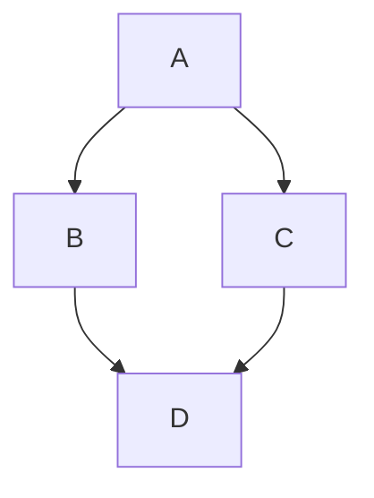

# Esta es una prueba para la pagina web

texto aquí

## Softwares de texto plano usados

- [Sublime](https://www.sublimetext.com/download)
- [MarkText](https://www.sublimetext.com/download)
- [Obsidian](https://obsidian.md)

### Paso 1

1. https://pandoc.org/installing.html
2. [Download the latest installer](https://github.com/jgm/pandoc/releases/latest)
3. [pandoc-3.11-windows-x86_64.msi](https://github.com/jgm/pandoc/releases/download/3.11/pandoc-3.11-windows-x86_64.msi)
4. Ejecutar instalador .msi
5. Ejecutar en PowerShell `pandoc .\mark_text_test.md -o .\mark_text_test.docx`




---

Hola! Soy **Fer**, persona fundadora de **Amatoria**. Aquí te comparto algunos hitos que dieron vida a este proyecto emergente de salud sexual para Chile 💚.

El html funciona solo hay que restringirlo para no modificar los CSS globales.

```text
<style>
  body {
    font-family: 'Roboto', sans-serif;
    background-color: transparent;
    margin: 0;
    padding: 0;
  }
  
  .timeline {
    position: relative;
    max-width: 800px;
    margin: 0 auto;
    padding: 20px 0;
  }

  /* La línea vertical central (Desktop) */
  .timeline::after {
    content: '';
    position: absolute;
    width: 2px;
    background-color: #3AA7A3; 
    top: 0;
    bottom: 0;
    left: 50%;
    margin-left: -1px;
    z-index: 0;
  }

  .container {
    padding: 10px 40px;
    position: relative;
    background-color: inherit;
    width: 50%;
    box-sizing: border-box;
  }

  /* Círculos en la línea */
  .container::after {
    content: '';
    position: absolute;
    width: 12px;
    height: 12px;
    right: -9px;
    background-color: white;
    border: 3px solid #9966CC;
    top: 20px;
    border-radius: 50%;
    z-index: 1;
  }

  .left { left: 0; text-align: right; }
  .right { left: 50%; text-align: left; }
  .right::after { left: -9px; }

  .year {
    font-weight: 900; /* Roboto Extra-bold */
    font-size: 1.2rem;
    color: #353a3c;
    display: block;
    margin-bottom: 5px;
  }

  .milestone {
    font-size: 0.95rem;
    color: #555;
    margin-bottom: 10px;
    line-height: 1.4;
  }

  /* --- RESPONSIVE: Ajuste para Teléfonos --- */
  @media screen and (max-width: 600px) {
    /* Movemos la línea a la izquierda */
    .timeline::after {
      left: 31px;
    }

    .container {
      width: 100%;
      padding-left: 70px;
      padding-right: 25px;
      text-align: left !important;
      left: 0 !important;
      margin-bottom: 20px;
    }

    .container::after {
      left: 22px;
      right: auto;
    }
  }
</style>

<div class="timeline">
  <div class="container left">
    <span class="year">2026 | El momento</span>
    <p class="milestone"><strong>Amatoria</strong> es realidad. Es ahora o nunca. Al servicio de Chile.</p>
  </div>
  
  <div class="container right">
    <span class="year">2025 | La comunicación</span>
    <p class="milestone">Congreso de sexología. Clases sobre el microbioma vaginal. Fin del doctorado en biotecnología.</p>
  </div>

  <div class="container left">
    <span class="year">2024 | La unión</span>
    <p class="milestone">Formación en sexología clínica y trauma sexual. Nace la idea de <strong>Amatoria</strong>: con cariño y ciencia.</p>
  </div>

  <div class="container right">
    <span class="year">2023 | El rigor</span>
    <p class="milestone">Tesis doctoral sobre pH y microecología. Especialización en análisis de datos.</p>
  </div>

  <div class="container left">
    <span class="year">2018 | La resiliencia</span>
    <p class="milestone">Primer proyecto de salud sexual (falló). Inicio formal de I+D contra infecciones vaginales.</p>
  </div>

  <div class="container right">
    <span class="year">2016 | El hallazgo</span>
    <p class="milestone">Título de Ingeniería. Descubro la conexión entre la microbiota vaginal y el nacer humano.</p>
  </div>

  <div class="container left">
    <span class="year">2003 | La evolución</span>
    <p class="milestone">Animación de caricaturas eróticas y el segundo regaño familiar, esta vez de mi padre.</p>
  </div>

  <div class="container right">
    <span class="year">2000 | La chispa</span>
    <p class="milestone">Primer interés por la sexología: caricaturas de órganos sexuales y el regaño de mi madre.</p>
  </div>
</div>
```